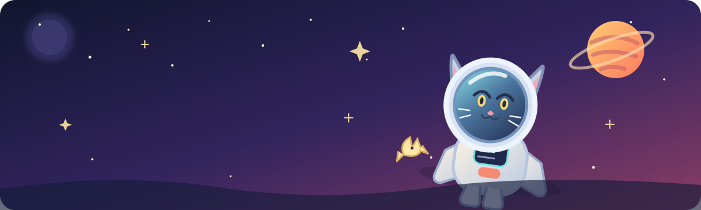

# 🐾 HUNGRY PAWS

### One curious cat. One big neighborhood. Six mice standing between you and a full belly.

**A playful 3D cat-exploration game by Beura Labs.**

  
  

  
  
  

---

## 🌙 The idea

**Hungry Paws** drops you into the paws of a very determined cat. Explore a colorful neighborhood, sniff out prey, pounce on mice, dodge trouble, collect treats, and keep that hunger meter from reaching a dramatic conclusion.

It is an **early playable prototype** of a much bigger open-world game idea. The Neighborhood is the current playable area; other world slots and larger expansions are not finished yet. This README is the launchpad, not a claim that the whole future universe is already built. 🪐

## 🎮 Gameplay

- **Explore the Neighborhood** in a real-time 3D environment.
- **Hunt six mice** to complete a run, including a special golden mouse.
- **Manage hunger** by catching prey and collecting treats.
- **Use cat moves** such as jumping, sliding, sniffing, pouncing, and attacking.
- **Meet neighborhood life**, including other cats, dogs, birds, and other moving characters.
- **Unlock the cat vibe** with treat-based coat/cosmetic progression.
- **Keep your bests** with browser-local progress saving.

## 🕹️ Controls

| Action | Keyboard |
| --- | --- |
| Move | **W A S D** or **Arrow keys** |
| Sprint | **Shift** |
| Jump | **Space** |
| Slide | **C**, **X**, or **Ctrl** |
| Sniff / track | **E** or **F** |
| Attack | **Z** or **J** |
| Pause / resume | **Esc** or **P** |
| Start | **Enter** |

On touch devices, use the on-screen controls. The game is designed to run in a modern browser with WebGL support.

## 🚀 Play it

### The neighborhood is waiting. The mice are making poor life choices.

Live demo hosted on Vercel · Browser required · No installation needed

## 🧰 Built with

- **HTML, CSS, and JavaScript** in a single-page, single-file game.
- **Three.js** for the real-time 3D scene, loaded from a CDN.
- **Web Audio API** for game sound.
- **Local storage** for saving progress in the current browser.

Because the game loads its 3D library and fonts from external CDNs, an internet connection is required when opening it for the first time or after clearing the browser cache.

## 🗺️ What's next

Hungry Paws is at the beginning of its journey. The longer-term vision is to grow it into a richer open-world cat adventure, with more places to explore, additional activities, deeper progression, and more reasons to follow a suspicious noise behind a garden fence.

**Current reality:** one main playable Neighborhood area, with further world slots locked or unfinished. Future ideas are plans, not features that are already shipped.

## 🐞 Feedback

Found a bug, odd movement, or a mouse that has apparently transcended the laws of physics? Record what happened and the device/browser used so it can be reproduced.

## © Credits & rights

Created by **Satyajit Beura · Beura Labs**.

The original game source, original project artwork, name, and branding are reserved by the creator. See [LICENSE](LICENSE). Third-party libraries and services remain subject to their own terms and licenses.

---

**HUNGRY PAWS** · Made for curious explorers and aggressively hungry cats. 🐈‍⬛

Stay curious. Follow the paw prints.

